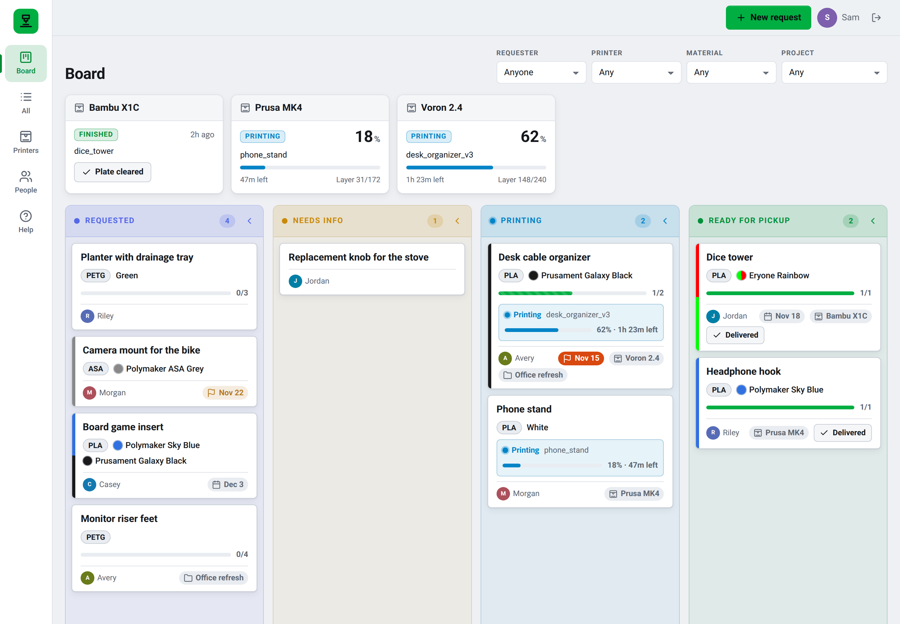
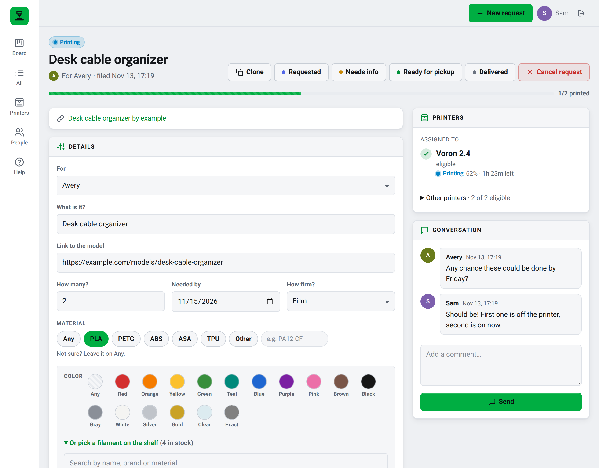
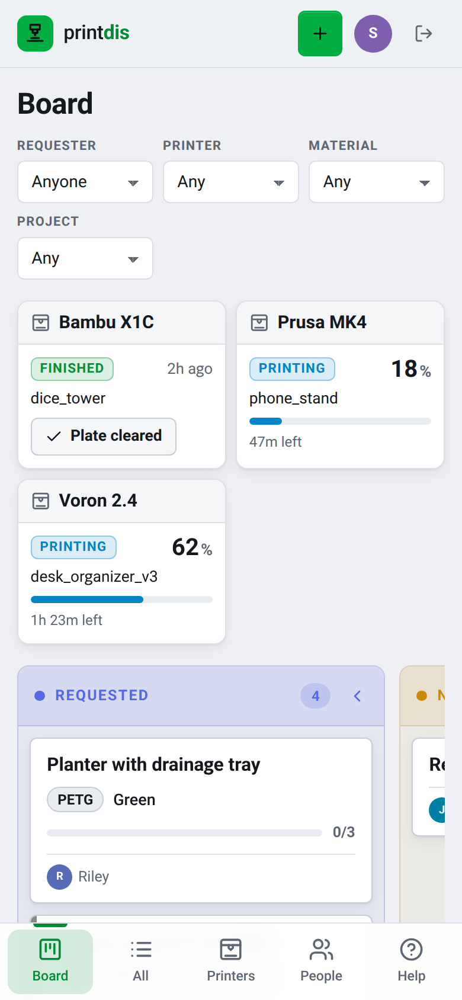
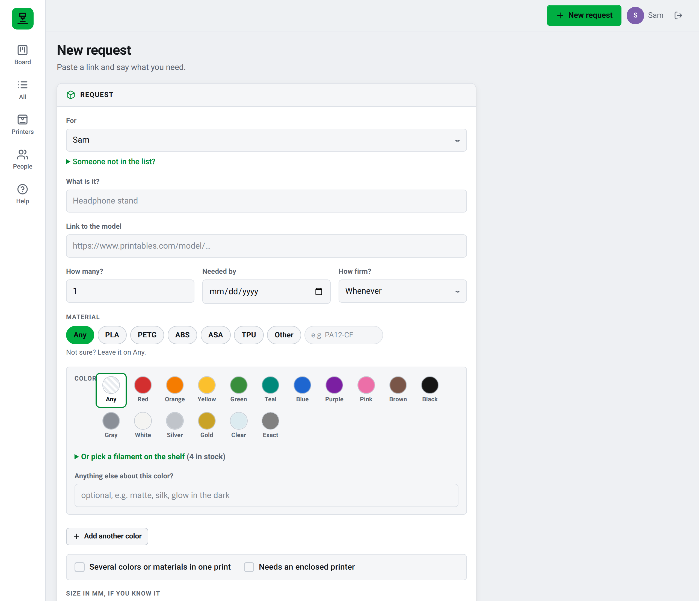

# print-dis

A single queue for 3D print requests from friends. Friends sign in through Authentik, file a request with a link or a model file, and follow its progress. The owner sees everything on a board, along with the filament each request needs, its deadline and which printers can handle it.



<p>
  
  
</p>



See [`docs/design.md`](docs/design.md) for the design.

## Running locally

```sh
make db     # Postgres in podman on :55432
make run    # http://localhost:8080, signed in as an admin via DEV_USER
```

`make screenshots` regenerates the images above from made-up data (needs `make db` and Chromium).

## Configuration

Environment variables only. See section 7 of the design for the full list. Required: `DATABASE_URL`, `BASE_URL`, and either the `OIDC_*` trio or (localhost only) `DEV_USER`.

## Image

`ghcr.io/bjschafer/print-dis:main`, built by CI on every push to `main`. It runs as non-root and is happy with a read-only root filesystem.
